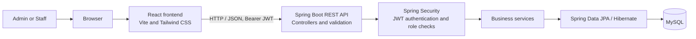
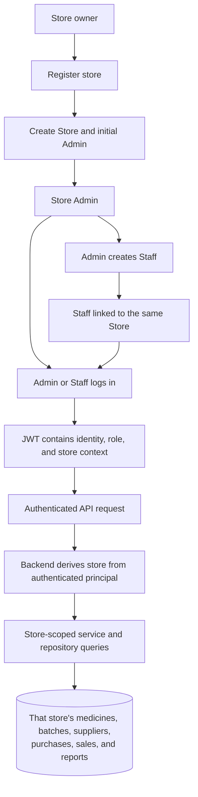
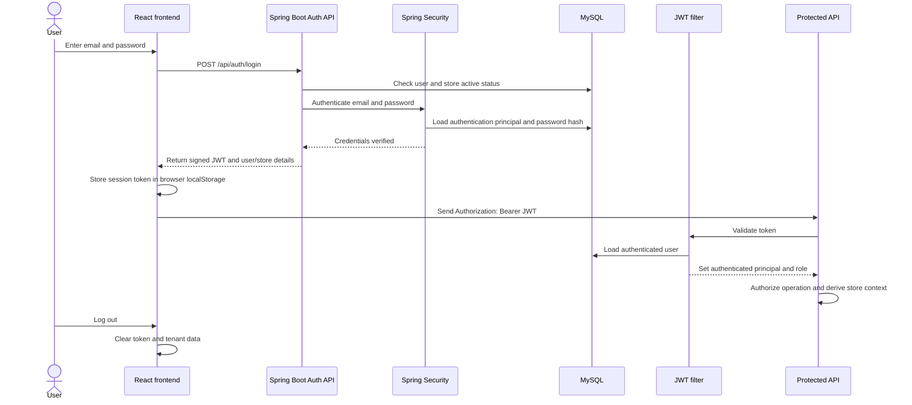

# Medical Store Inventory and Sales Management System

A web application for managing the day-to-day operations of independent medical stores. Store owners can register a store, administer staff, and manage store-specific medicines, inventory, suppliers, purchases, sales, and reports.

> **Project status:** Core frontend and backend flows are implemented. The backend build, automated tests, and frontend production build have passed locally. A live MySQL/API end-to-end run has not been performed.

## Overview

Medical stores often track stock, batches, expiry dates, purchases, and sales manually. This can make it difficult to keep inventory accurate, find expiring products, and understand store performance.

This project provides a React interface backed by a Spring Boot REST API and a MySQL database. Each registered store has its own Admin account and tenant-scoped business data. Staff accounts are created by that store's Admin.

## Problem Statement

- Manual inventory records are difficult to keep current.
- Batch and expiry information can be overlooked.
- Sales and purchase records are harder to reconcile when maintained separately.
- Store owners need a simple way to manage staff and review business activity.
- A shared application must prevent one store from reading or changing another store's records.

## Objectives

- Provide a single interface for common medical-store operations.
- Track medicines and batch-level quantities and expiry dates.
- Record sales and purchases and update inventory through the backend.
- Provide role-based Admin and Staff experiences.
- Support independent store registration and isolate store data using the authenticated user's tenant context.

## Key Features

### Store registration and profile

- Public registration creates a store and its first Admin account.
- Registration collects owner and store details and validates submitted data.
- Admins can view and update their authenticated store's profile.
- Store name and profile information are displayed dynamically in relevant parts of the interface.
- Public Staff registration is disabled; Admins create and manage Staff accounts.

### Inventory and operations

- **Medicines:** store-scoped medicine catalog and Admin-managed records.
- **Inventory:** batch number, quantity, prices, manufacture/expiry dates, and expiry/low-stock indicators.
- **Suppliers:** Admin-managed supplier directory.
- **Purchases:** Admins can record purchases; backend purchase processing updates stock.
- **Sales:** Admins and Staff can record sales; backend sale processing updates stock.
- **Dashboard and reports:** store-scoped summary and sales/inventory reporting.
- **Invoices:** sale invoice details include the current store's information.
- **Reports:** the UI supports CSV export and browser printing.

### Roles in the application

| Role  | Main interface capabilities                                                                                 |
| ----- | ----------------------------------------------------------------------------------------------------------- |
| Admin | Dashboard, medicines, inventory, sales, purchases, suppliers, reports, staff management, and store settings |
| Staff | Dashboard, medicine catalog, inventory viewing, and sales                                                   |

The interface hides Admin-only pages from Staff, and backend endpoints apply role checks to protected operations. See [Authentication and security](#authentication-and-security) for a documented report-endpoint limitation.

## Technologies

| Area            | Technologies                                                                                       |
| --------------- | -------------------------------------------------------------------------------------------------- |
| Frontend        | React 18, JavaScript, Vite, Tailwind CSS, Lucide React                                             |
| Backend         | Java 17, Spring Boot 3.3, Spring Web, Spring Security, Spring Data JPA, Hibernate, Bean Validation |
| Authentication  | JSON Web Tokens (JJWT), BCrypt                                                                     |
| Database        | MySQL                                                                                              |
| Build and tests | npm, Maven, JUnit, Spring Boot Test                                                                |

## System Architecture

The frontend calls the Spring Boot REST API. The backend applies authentication and authorization, runs business services, and accesses MySQL through Spring Data JPA/Hibernate.



### Multi-store workflow

Each Admin and Staff member belongs to a store. Business operations take the store ID from the authenticated backend principal; clients do not select a tenant ID to access records.



### Authentication workflow



The registration endpoint is public and creates the first Admin for a new store. Registration currently redirects the user to the login screen rather than automatically signing them in.

## Multi-Tenant Architecture

- `stores` holds store profiles.
- `users.store_id` links each Admin or Staff account to a store.
- Medicines, batches, suppliers, purchases, and sales have a store relationship.
- Controllers obtain the store ID from the authenticated user principal and pass it to store-scoped services.
- Record lookups and mutations use both the record ID and authenticated store ID.
- The database schema defines foreign keys and indexes for the tenant relationships.

### Database overview

| Table                          | Purpose and relationships                                        |
| ------------------------------ | ---------------------------------------------------------------- |
| `stores`                       | Store name, owner, contact details, address, license, and status |
| `users`                        | Admin and Staff accounts; each user references a store           |
| `medicines`                    | Store-specific medicine catalog                                  |
| `medicine_batches`             | Store-specific stock batches linked to medicines                 |
| `suppliers`                    | Store-specific supplier records                                  |
| `purchases` / `purchase_items` | Purchase headers and their line-item snapshots                   |
| `sales` / `sale_items`         | Sales headers and their line-item snapshots                      |

The purchase and sale line-item tables store transaction details. They are linked to their respective transaction headers; their item rows are not modeled as foreign-key links to medicine records.

### Current authorization note

The frontend limits Reports & Analytics to Admin users, and the dashboard report data is scoped to the authenticated store. However, `GET /api/reports/dashboard` is currently authenticated and tenant-scoped but does **not** enforce Admin-only access in the backend. Do not treat the UI restriction as an API security boundary; add a backend role check if reports must be restricted to Admins.

## Authentication and Security

- Passwords are hashed with BCrypt.
- Login issues a signed JWT. The configured token lifetime is 24 hours.
- The frontend sends the token in the `Authorization: Bearer ...` header and persists it in browser `localStorage` so the session can be restored after refresh.
- The backend uses stateless Spring Security and validates JWTs on protected requests.
- Registration and login are public; business APIs require authentication, with role checks on selected Admin operations.
- Store profile reads use the authenticated user's store; profile updates are Admin-only.
- Public Staff registration is disabled.

The frontend API client currently targets `http://localhost:8080/api`; the local Vite origin on port `5173` is allowed by backend CORS configuration.

## Project Structure

```text
medical-store-inventory-system/
├── backend/
│   ├── schema.sql
│   ├── schema/
│   │   └── migration/
│   │       └── V2__multitenant.sql
│   ├── pom.xml
│   └── src/
│       ├── main/
│       │   ├── java/com/medstore/
│       │   │   ├── config/       # Spring Security and application setup
│       │   │   ├── controller/   # REST endpoints
│       │   │   ├── dto/          # API request and response types
│       │   │   ├── model/        # JPA entities
│       │   │   ├── repository/   # Spring Data repositories
│       │   │   ├── security/     # JWT and authenticated principal
│       │   │   └── service/      # Business and tenant-scoped operations
│       │   └── resources/
│       │       └── application.properties
│       └── test/java/com/medstore/
├── public/                       # Static frontend assets
├── src/
│   ├── components/               # Shared UI components
│   ├── context/                  # Authentication and store data state
│   ├── data/                     # Shared static UI data
│   ├── pages/                    # Application screens
│   ├── services/                 # HTTP API client
│   ├── utils/                    # Formatting helpers
│   ├── App.jsx
│   └── main.jsx
├── package.json
└── README.md
```

The frontend selects screens through application state in `App.jsx`; it does not currently use a URL-based router.

## Prerequisites

- Java Development Kit (JDK) 17
- Maven
- Node.js and npm
- MySQL Server and MySQL command-line client
- Git

## Database setup

The application uses the `medical_store_db` database. Choose **one** of the following setup paths.

### Fresh database

From the repository root in **Command Prompt (`cmd.exe`)**, run the schema script. It creates the database and application tables:

```cmd
mysql -u YOUR_MYSQL_USER -p < backend\schema.sql
```

The script creates no sample users. Register a store through the application to create its first Admin.

### Existing database created from the original single-tenant schema

> **Important: Back up your existing database before migration.** Store the backup securely outside the repository; it may contain private business data.

From the repository root in **Command Prompt (`cmd.exe`)**, make a backup:

```cmd
mysqldump -u YOUR_MYSQL_USER -p medical_store_db > medical_store_db_before_multitenant.sql
```

After confirming the backup, apply the one-time migration:

```cmd
mysql -u YOUR_MYSQL_USER -p < backend\schema\migration\V2__multitenant.sql
```

This migration is for the original schema, which contained a `users` table without a `store_id`. It preserves user rows and password hashes, creates a separate legacy store, and assigns the old users to that store. Its legacy profile contains placeholder contact/address values that should be updated in Store Settings. The original schema did not define the business tables; Hibernate's configured `ddl-auto=update` creates missing entity tables when the backend starts.

**Run this migration once only.** It alters `users` and is not safe to rerun. Do not use it on a fresh database or on a database that has already been migrated. If the existing database has a different or partially migrated schema, inspect it and prepare a reviewed migration before starting the application. Do not run `schema.sql` as a substitute for migrating an existing database.

## Environment variables

The backend reads these variables from its process environment. Set them in the terminal or IDE run configuration that launches Spring Boot; do not commit real values to the repository.

| Variable      | Required | Purpose                                              |
| ------------- | -------- | ---------------------------------------------------- |
| `DB_USERNAME` | Yes      | MySQL account used by the backend                    |
| `DB_PASSWORD` | Yes      | Password for that MySQL account                      |
| `JWT_SECRET`  | Yes      | JWT signing key; provide at least 32 bytes for HS256 |

The database URL, database name, port, and token lifetime are configured in `backend/src/main/resources/application.properties`. The frontend API base URL is configured in `src/services/api.js`.

## Run the application

### Backend

Open PowerShell at the repository root. Set the three required environment variables locally, then run:

```powershell
Set-Location .\backend
mvn clean compile
mvn test
mvn spring-boot:run
```

The API listens at `http://localhost:8080`.

### Frontend

Open a second terminal at the repository root:

```powershell
npm install
npm run dev
```

Open the Vite URL printed in the terminal (normally `http://localhost:5173`). Register a store to create its first Admin, then log in. There are no seeded demo accounts.

### Production frontend build

From the repository root:

```powershell
npm run build
```

To preview the generated build locally:

```powershell
npm run preview
```

## Tests and build status

Last verified locally during this implementation:

| Check               | Result                                                   |
| ------------------- | -------------------------------------------------------- |
| `mvn clean compile` | Passed                                                   |
| `mvn test`          | Passed: 12 tests, 0 failures, 0 errors                   |
| `npm run build`     | Passed                                                   |
| `git diff --check`  | Passed; Git emitted only line-ending conversion warnings |

The backend tests include registration success/password mismatch/duplicate email cases, request validation, and service-level tenant-scope checks for medicines, inventory batches, suppliers, purchases, sales, and staff. The tenant tests use mocked repositories; they are not HTTP integration tests. No live MySQL/API or browser end-to-end run has been completed, so deployment-specific behavior still needs local verification.

## Future Enhancements

- Add authenticated HTTP integration tests using a disposable MySQL-compatible test database.
- Enforce Admin-only access to financial reports at the backend if that is the intended policy.
- Add browser-level tests for registration, login, role visibility, and operational workflows.
- Add optional barcode support and configurable notification delivery for low stock and expiry.
- Add deployment documentation and production environment configuration.

## Team and Project Information

- **Team:** G72
- **Program:** B.Tech Computer Science & Engineering
- **Project type:** Academic project

No separate open-source license file is currently included in the repository.
